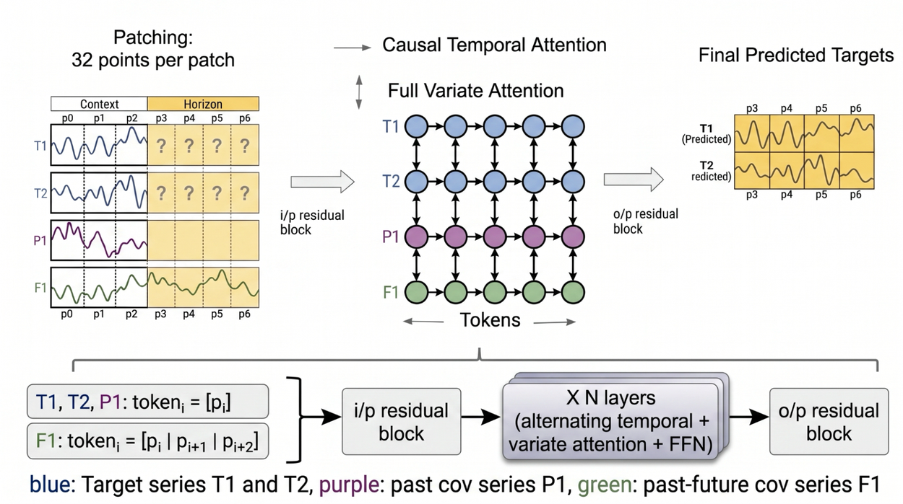
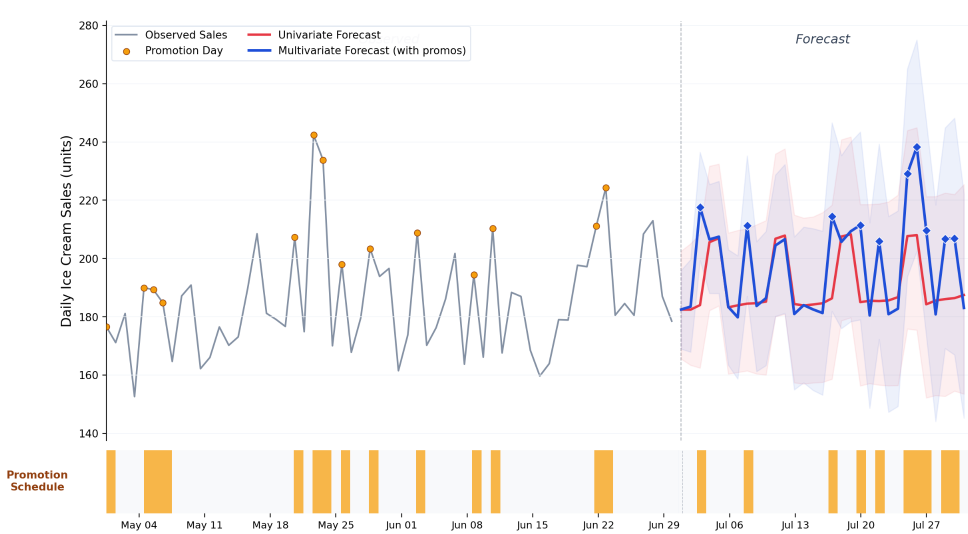
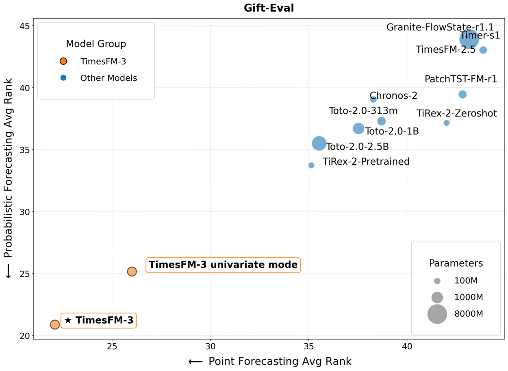
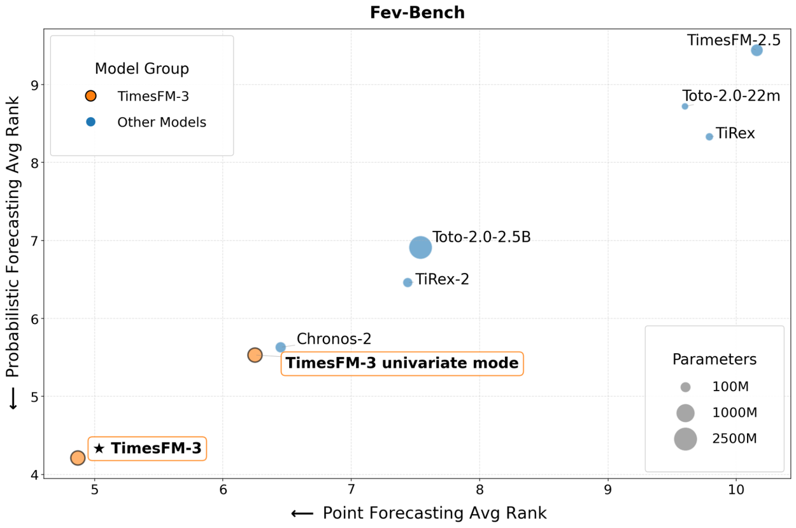
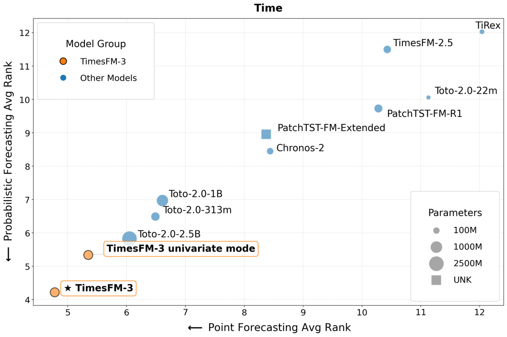

# TimesFM-3: A zero-shot foundation model for multivariate forecasting

## Research Blog

https://www.research.google/blog/timesfm-3-a-zero-shot-foundation-model-for-multivariate-forecasting

## 요약

### TimesFM-2.5를 간단하게 보고, 3로 넘어가도록 하겠다.

### TimesFM-2.5

모델 사이즈나 파라미터 변경이 더 많고. 특징점은 XReg가 추가되었다.

사이즈는 500M에서 200M으로 줄어들었고, Max Context가 16,384로 늘어났다. (14일에서 114일로 늘어난셈)

기존 TimesFM-2.0에서 Continuous Quantile Head를 붙혀서 TiRex처럼 Quantile 0.1~0.9 예측이 가능해졌다.

**Exogenous Regression (XReg)**

외생변수를 활용한 Regression이다.

즉석에서 회귀식을 계산하는 통계모델링 방법론을 사용한다.

regression coefficient(Ridge를 좀 이해해야할듯)를 계산해서 effect를 input에 먼저 반영하던가, 혹은 output에 반영하는 형태로 한다.
예를 들어, input 1이 100이었는데, effect를 계산해보니 input1은 월요일이라서 -25한다. 라는 계수가 나오면 그걸 반영해서 75를 인풋하는 형태이다.
아니면 output1을 봤는데, output1은 토요일이니까 +10한다. 라는 계수가 나오면 그걸 반영해서 +10을 하는 개념이다.

TimesFM 논문에서 limitation을 기억하는가? prompt같은걸 줄 수 없어서 Regression을 하면 좋을거 같다는 Future works를 남겨놓는데, 그걸 구현해놓은 모습이다.

### TimesFM-3.0

### Introduction

대부분의 문제는 단변량이 아니고 다변량이다. 소매 체인 아이스크림 매출 예측을 고려해봐라. 관련 제품의 판매량과 유동인구, 일기예보, 프로모션, 휴일 같은 미래 이벤트들을 참고해야한다.

다변량 시나리오를 제로샷 방식으로 지원한다고한다. (TimesFM-2.5의 방식에서 뭔가 변경점이 있을듯.)

- 여러 시계열을 동시에 예측할 수 있다. (여러 아이스크림의 판매량)
- 공변량 추가가 가능하다.
- 계획된 프로모션같은 미래 공변량도 추가 가능하다.

### Architecture & Inference

TimesFM-2.5의 시계열 정규화 방식을 사용했고, 그 외의 형태는 전부 TimesFM 논문의 그것을 따르는 것 같다.

TimesFM에서는 첫 번째로 유효한 patch의 평균과 표준편차로 전체를 정규화한다고 하였다.
이 부분에서 나는 첫번째 패치와 이후 패치의 값 스케일 차이가 크면 좀 이상해질 거 같은데, 사실 상대적인거라 상관없나 이런생각도 했었다.

TimesFM-2.5에서는 patch1에서 정규화한 값을 patch2에서 다시 정규화해서 업데이트한다. (patch2에서는 patch1, patch2로 평균 표준편차 정규화를 함)

이러면 어느정도 현재 패치에서의 스케일을 잘 반영하면서 정규화가 가능할 것 같기도 하다.
그래도 나는 좀 찜찜한게, 정규화라는건 어느정도 absolute한 기준값으로 딱 균일하게 되어야 한다고 생각하는데, 이거는 뭐 patch마다 달라지니까, normalization coordinate가 달라지는데.... 이거 괜찮은건지...;; 좀 의아하다. 백번 양보해서 정규화 방식이야 뭐 학습과 예측을 동일하게만 하면 모델 학습이 잘 됐을때 영향은 없으니까 뭐 괜찮다고 봐야할지...

### Multivariate token construction

위에서 미래 공변량에 대한 얘기를 했는데, 여기서는 미리보기라는 전략을 사용한다고 한다. (그냥 한 줄 소개글이라서 이렇게밖에 번역할 수 없음)

### Alternating attention architecture

여기서 **Multivariate token construction**가 좀 더 명확하게 설명된다.

Target을 T1,T2로 설명해놨고, 미래를 알 수 없는 feature를 P1, 미래를 알 수 있는 feature를 F1로 표현하였다.
쉽게 설명하면 P1은 유동인구라고 볼 수 있다. 이거는 미래의 유동인구를 미리 알 수 없는 공변량이다.
F1은 프로모션 집행비용같은걸 따져볼 수 있다. 프로모션 집행비는 1달이던 2달이던 정해진 기간안에 일별 총 금액이 있을 수 있으므로, 미래에 어떤 값이 있을지 알 수 있다.

[배치**,특징**,패치,**패치당 시간**] -> [배치 **x 특징**,패치,**hidden_size**] -> Causal temporal attention (패치별 디코딩 어텐션이라고 보면 됨) -> [배치,특징,패치,hidden_size] -> [배치 **x 패치**, 특징, hidden_size] -> Full variate attention (특징들끼리 Full attention 진행)

즉, axis를 변경해가며 시계열에 대한 교사강요 attention 한 번과 특징에 대한 full attention 1번을 진행하게된다.

예를 들어, p3을 예측하는 경우라면, T1, T2와 P1은 mask인 상태로, F1의 p3와 어텐션하게된다. 따라서, Causal temporal attention에서 교사강요된 이전 시계열 값의 관계를 파악한 다음, F1의 p3이라도 살아있는 특징값과의 관계를 한번 더 계산해볼 수 있게되는 셈이다.

### Non-autoregressive decode: Forecasting in a single pass

TiRex의 [Contiguous Patch Masking(CPM)](https://github.com/YooSungHyun/paper-review/tree/master/Time-Series/TiRex#2-tirex)을 그대로 레퍼런스하며, 단 여기는 프로모션이나 주말여부와 같은 미래를 알 수 있는 Feature들도 들어가니까, 그 부분들을 고려해서 CPM을 설계했다고 한다. (사실상 axis만 다른거고 무작위 Masking 그대로 적용하면 될 듯)

이렇게 되면 장점이 이전에 TimesFM-2.5 전까지는 물론 롤링 필요가 덜 해지는거지, 필요가 없는 것은 아니었는데, 지금같은 경우는 그냥 예측하고싶은 기간어치를 mask로 두고 한방에 뽑으면 되니까 롤링이 아예 필요가없다. (단, mask가 그래도 학습 분포에 있었던 만큼만 넣어야겠지~~)

### Illustrative example for multivariate forecasting

시계열만 보는 방식인 우측 빨간선은, 사실상 패턴성밖에 잡아내지 못한다. 하지만 다변량으로 들어간 파란선의 경우, 프로모션 주기에 따른 좀 더 다채로운 값을 뽑아내는 것을 알 수 있다.

### Evaluation and benchmarks

모델 사이즈대비 그저 GOAT

## 마치며

심플하면서도 대단한 성과인 것 같다. 모델 사이즈도 씹어먹는다는 점에서 꽤나 전도유망하지 않을지....

언어모델에서 이런거로 갈아타고싶다...
